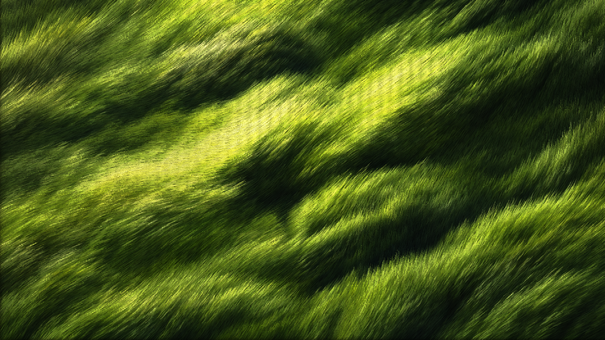

# ASCII 草浪

黄绿色 ASCII 草浪的两种呈现：固定草根、分区转向的实时草叶，以及按提供视频原始节奏播放的运动版。

[打开在线预览](https://shataojin.github.io/ascii-grass-wallpaper/) · [下载壁纸和 Unity 工程](https://github.com/shataojin/ascii-grass-wallpaper/releases/latest)

| 版本 | 呈现方式 | 使用场景 |
| --- | --- | --- |
| 原视频运动版 | 提供的视频裁切后播放，保留 30 FPS 和原始运动节奏 | 对照参考、视频壁纸、Unity VideoPlayer |
| 实时草叶版 | 160000 根 GPU 草叶，草根固定，相邻草叶共享风向，区域错开转向，字符跟随方向场 | 可调整风速和亮度的动态桌面、Unity 场景 |

## 在线预览

打开预览后可切换两个版本。视频默认保留原始画面比例；实时版适应横屏。H 显示设置，空格暂停。

## Wallpaper Engine

在 Releases 中下载所需包并解压：

- `WallpaperEngine-Reference-Video.zip`：把 `grass-reference.mp4` 导入 Wallpaper Engine。选择“适应/保留比例”可看到完整竖幅，选择铺满会裁切画面。
- `WallpaperEngine-ASCII-Grass.zip`：在 Wallpaper Engine 中创建 Web 壁纸，导入包内 `index.html`。资源均已包含，可完全离线运行。

也可以直接下载整个仓库：两个壁纸源文件分别位于 `docs/reference-video` 和 `docs/realtime`。

## Unity

建议使用 Unity **6000.3.21f1**，内置渲染管线（Built-in）。通过 Unity Hub 添加仓库内 `Unity-ASCII-Grass` 目录。

- `Assets/ASCIIGrass/Scenes/01_Reference_Portrait.unity`：实时竖幅。
- `Assets/ASCIIGrass/Scenes/02_Desktop_Wallpaper.unity`：实时横幅。
- `Assets/ASCIIGrass/Scenes/03_Original_Video_Motion.unity`：原视频运动版。

在 Play 模式按 H 打开设置、空格暂停、F11 切换全屏。视频位于 `Assets/StreamingAssets/VideoReference`。导入其他项目时，可使用 Release 附带的 `ASCII-Grass.unitypackage`。

## 运动与验证

实时版使用分区方向场驱动弯曲草叶，源图颜色固定在草根上。草根不平移，各区域转向相位不同；叶尖有轻微独立摆动。循环周期为 12 秒，风速 1 时对应 12 秒一轮。

实际 GPU 检查结果见 `validation/natural-motion-validation.json`：四个 GLSL 程序编译通过，抽样草根顶点保持固定，叶尖有运动，邻域方向连续，区域之间方向不同；零风力时帧一致，12 秒首尾帧一致。Unity C# 已对安装的 Unity 参考程序集编译通过。当前环境的 Unity 编辑器许可证校验失败，因此尚未在 Unity 编辑器内验证 HLSL 和视频播放。

原视频运动版保留提供录制的全部 383 帧，只裁去手机界面并去除音频。重新播放录制时可能出现轻微衔接变化，未将它标为逐像素无缝循环。

## 素材说明

参考画面原作者标注为“宇森 Yusen”，由使用者提供截图和录制视频。横向草地底图使用内置图像生成工具根据参考进行想象扩展。原视频运动版采用提供录制的画面，实时版使用生成底图驱动程序草叶。

本仓库不包含原始手机截图或完整手机录屏。素材权益归相应权利人；发布不构成对原始参考素材的额外授权。
