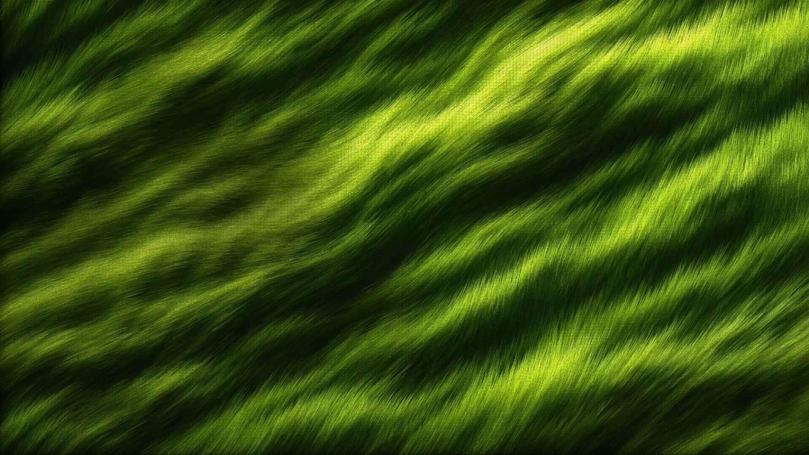

# ASCII 草浪

黄绿色 ASCII 草浪的两种呈现：版本1为平滑循环视频，版本2为实时 GPU 草叶。

[打开在线预览](https://shataojin.github.io/ascii-grass-wallpaper/) · [下载壁纸和 Unity 工程](https://github.com/shataojin/ascii-grass-wallpaper/releases/latest)

| 版本 | 呈现方式 | 使用场景 |
| --- | --- | --- |
| 版本1 | 以生成底图为草叶采色，固定草根、明显成片转向，明暗随朝向变化，稳定字形，10 秒循环 | 横屏视频壁纸、Unity VideoPlayer |
| 版本2 | 160000 根 GPU 草叶，草根固定，相邻草叶共享风向，区域错开转向，字符跟随方向场 | 可调整风速和亮度的动态桌面、Unity 场景 |

## 在线预览

打开预览后可切换“版本1”和“版本2”，均适应横屏。H 显示设置，空格暂停。

网页右下角显示 Sha Taojin 和 GitHub 头像，默认 35% 不透明度。点击“水印”调节不透明度，调到 0% 即可隐藏；选择会保存在当前浏览器中。Wallpaper Engine 的属性面板也提供相同调节器。

## Wallpaper Engine

在 Releases 中下载所需包并解压：

- `Version1-Wallpaper.zip`：导入 `index.html` 为 Web 壁纸，可调节水印；也可直接导入 `grass-visible.mp4` 播放横屏视频。
- `Version2-Wallpaper.zip`：在 Wallpaper Engine 中创建 Web 壁纸，导入包内 `index.html`。资源均已包含，可完全离线运行。

也可以直接下载整个仓库：两个壁纸源文件分别位于 `docs/reference-video` 和 `docs/realtime`。

## Unity

建议使用 Unity **6000.3.21f1**，内置渲染管线（Built-in）。通过 Unity Hub 添加仓库内 `Unity-ASCII-Grass` 目录。

- `Assets/ASCIIGrass/Scenes/01_Reference_Portrait.unity`：实时竖幅。
- `Assets/ASCIIGrass/Scenes/02_Desktop_Wallpaper.unity`：实时横幅。
- `Assets/ASCIIGrass/Scenes/03_Original_Video_Motion.unity`：版本1横屏扩图视频。

在 Play 模式按 H 打开设置、空格暂停、F11 切换全屏。视频位于 `Assets/StreamingAssets/VideoReference`。导入其他项目时，可使用 Release 附带的 `ASCII-Grass.unitypackage`。

## 运动与验证

版本2使用分区方向场驱动弯曲草叶，源图颜色固定在草根上。草根不平移，各区域转向相位不同；叶尖有轻微独立摆动。循环周期为 12 秒，风速 1 时对应 12 秒一轮。

实际 GPU 检查结果见 `validation/natural-motion-validation.json`：四个 GLSL 程序编译通过，抽样草根顶点保持固定，叶尖有运动，邻域方向连续，区域之间方向不同；零风力时帧一致，12 秒首尾帧一致。Unity C# 已对安装的 Unity 参考程序集编译通过。当前环境的 Unity 编辑器许可证校验失败，因此尚未在 Unity 编辑器内验证 HLSL 和视频播放。

版本1使用内置 `image_gen.imagegen` 生成的整幅草地作为静态采色来源，绘制 160000 根固定草根的弯曲草叶。加长的叶尖沿区域方向场成片转向，叶片明暗随朝向变化，普通网页预览尺寸下也能看见运动。采用 10 秒解析周期、半浮点风场和超采样来平滑运动。字符形状由静态采色固定，随草叶方向平缓转动。完整输出为 1920×1080、30 FPS、300 帧，无音频。

版本1的草根、叶尖速度/加速度、字形稳定和首尾循环检查见 `validation/version1-visible-validation.json`；编码后的逐帧变化和循环衔接检查见 `validation/version1-visible-encoded-validation.json`。检查直接读取分布在全画面的 256 根草叶的实际 GPU 顶点和片段输出，并要求两秒内叶尖位移的第 75 百分位至少为 10 像素、640×360 预览的平均 RGB 变化至少为 5/255，同时约束速度、加速度和编码后的帧间突跳。生成底图的提示词见 `docs/reference-video/image-generation-prompt.txt`。

